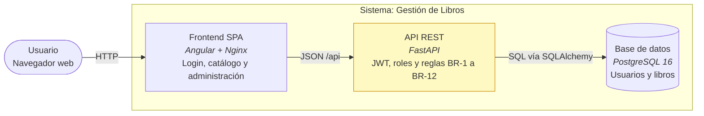
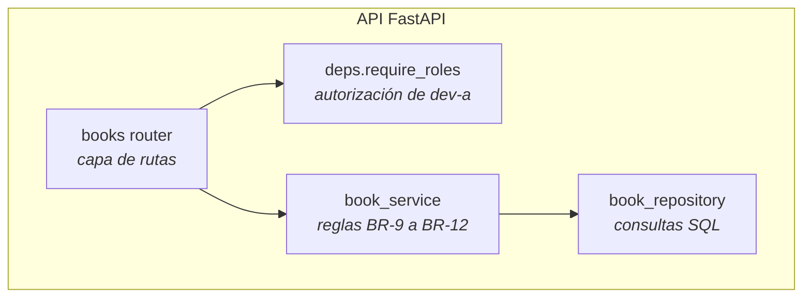

# Diagramas C4

## Qué nivel dibujar
| Situación del cambio | Nivel |
|---|---|
| Primer cambio del proyecto o un sistema externo nuevo | **Contexto** |
| Cruza contenedores (SPA ↔ API ↔ BD) | **Contenedores** |
| Cambia la estructura interna de un contenedor (capas, módulos) | **Componentes** |
| Cambio dentro de un solo componente | Ninguno: basta una nota en Decisions |

Como máximo 2 niveles por design.md.

## Reglas
1. **Formato por defecto: Mermaid `flowchart`** con `subgraph` como límites del sistema. No preguntes el formato.
2. Cada nodo muestra **nombre, tecnología y responsabilidad** (en español): `api[API REST <i>FastAPI</i> Reglas de negocio]`.
3. Cada flecha dice **qué y cómo**: `-->|JSON /api| `.
4. Como máximo unos 12 nodos por diagrama; si hay más, divide.
5. Respeta las capas y la dirección de dependencias de la arquitectura vigente. Si el diseño necesita romperlas,
   no lo dibujes como si nada: detente y sugiere `/adr-supersede`.
6. Marca lo nuevo, lo modificado y lo que no cambia con `classDef` (identificadores en inglés, etiquetas en español).

## Plantilla: Contenedores

## Plantilla: Componentes (capas)

