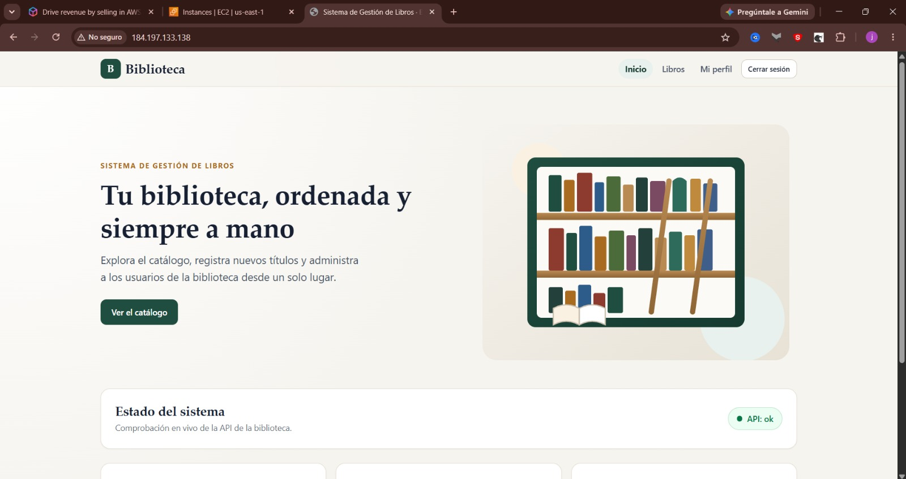
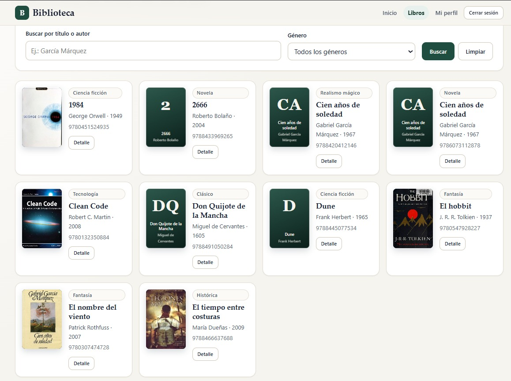
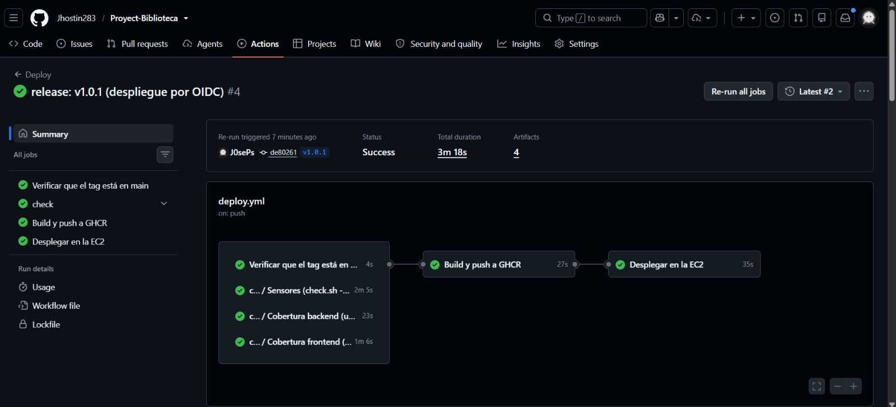
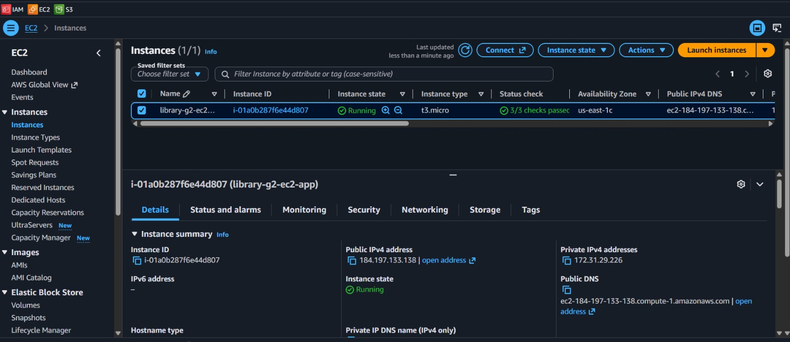

# library-g2 · Sistema de Gestión de Libros (Grupo 2)

[](https://github.com/Jhostin283/Proyect-Biblioteca/actions/workflows/ci.yml)
[](https://github.com/Jhostin283/Proyect-Biblioteca/actions/workflows/deploy.yml)
[](https://github.com/Jhostin283/Proyect-Biblioteca/releases)
[](https://github.com/Jhostin283/Proyect-Biblioteca)
[](https://github.com/Jhostin283/Proyect-Biblioteca)

Aplicación web full-stack para la gestión integral de un catálogo de libros y usuarios con control de acceso basado en roles (RBAC). Diseñada bajo metodología **Spec-Driven Development (SDD)** con OpenSpec, construida en dos máquinas coordinadas por un harness de agentes de IA (`dev-a` y `dev-b`), aprovisionada en **AWS con Terraform** y desplegada automáticamente mediante **GitHub Actions** en una instancia **EC2 t3.micro**.

---

## 🏛️ Arquitectura del Sistema

El proyecto implementa una arquitectura en capas contenedorizada mediante Docker Compose, desacoplando la presentación, lógica de negocio y persistencia:

```text
                                           ┌───────────────────────────────────────────────┐
                                           │              AWS EC2 (Ubuntu 24.04)           │
                                           │                                               │
  Usuario / Navegador                     │   ┌────────────────────────────────────────┐  │
          │                                │   │         Nginx (Reverse Proxy :80)      │  │
          │ HTTP :80                       │   │  - Servidor SPA Angular 19             │  │
          ▼                                │   │  - Redirección de /api hacia backend   │  │
    [ Elastic IP ] ───────────────────────►│   └───────────────────┬────────────────────┘  │
                                           │                       │                       │
                                           │                       │ http://backend:8000   │
                                           │                       ▼                       │
                                           │   ┌────────────────────────────────────────┐  │
                                           │   │            FastAPI (Python :8000)      │  │
                                           │   │  - Routers: Auth, Users, Books, Health │  │
                                           │   │  - Seguridad: JWT (HS256) + Argon2     │  │
                                           │   │  - ORM: SQLAlchemy + Alembic           │  │
                                           │   └───────────────────┬────────────────────┘  │
                                           │                       │                       │
                                           │                       │ postgresql://...:5432 │
                                           │                       ▼                       │
                                           │   ┌────────────────────────────────────────┐  │
                                           │   │       PostgreSQL 16 (Base de datos)    │  │
                                           │   │  - Tablas: users, books                │  │
                                           │   │  - Puerto 5432 aislado internamente    │  │
                                           │   └────────────────────────────────────────┘  │
                                           └───────────────────────────────────────────────┘
```

### Características de la Arquitectura
1. **Frontend (SPA en Angular 19)**: Estructura modular basada en componentes Standalone, inyección de dependencias reactiva (Signals / RxJS), interceptores HTTP para tokens JWT y Guards de navegación (`authGuard`, `roleGuard`).
2. **Reverse Proxy (Nginx)**: Punto único de entrada en el puerto 80. Sirve los activos estáticos del frontend con fallback para HTML5 PushState (`try_files $uri $uri/ /index.html`) y redirige las solicitudes de `/api/` hacia el contenedor del backend.
3. **Backend (API REST FastAPI)**: Arquitectura en capas limpia (`api` / `services` / `models` / `schemas` / `core`). Documentación OpenAPI interactiva, validación exhaustiva con Pydantic v2 y control de dependencias con `uv`.
4. **Persistencia (PostgreSQL 16 + Alembic)**: Modelado relacional con claves foráneas, restricciones de unicidad e índices optimizados en `isbn`, `title` y `author`. Control de esquema versionado mediante migraciones reproducibles de Alembic.
5. **Seguridad e Infraestructura en AWS**:
   - Servidor EC2 t3.micro optimizado para 1 GB de RAM (configuración de 2 GB de swap file).
   - Security Group restrictivo: puerto 80 abierto al público; puerto 22 cerrado al mundo y habilitado dinámicamente mediante rol **OIDC** solo durante el tiempo de ejecución del workflow de despliegue.

---

## 🛠️ Tecnologías Utilizadas

| Capa | Tecnologías |
|---|---|
| **Backend** | Python 3.12, FastAPI, Uvicorn, SQLAlchemy 2.0, Alembic, Pydantic v2, PyJWT, Pwdlib (Argon2), Pytest, Pytest-cov, Ruff, UV |
| **Frontend** | Angular 19, TypeScript, RxJS, Karma, Jasmine, CSS Variables (Design Tokens), Open Library Covers API |
| **Infraestructura & Cloud** | AWS EC2 (t3.micro), Elastic IP, AWS IAM (OIDC Trust Provider), Terraform (IaC) |
| **Contenedores & DevOps** | Docker, Docker Compose v2, GitHub Actions, GitHub Container Registry (GHCR) |
| **Metodología & Calidad** | OpenSpec (Spec-Driven Development), Git Flow, Architectural Decision Records (ADR) |

---

## 📸 Evidencias de Funcionamiento y Despliegue

### 1. Pantalla de Inicio del Sistema
Ilustración hero local SVG, comprobación reactiva del estado operativo de la API (`/api/health`) y accesos rápidos adaptados según el rol del usuario conectado.



---

### 2. Catálogo de Libros y Menú
Búsqueda de libros por título o autor insensible a mayúsculas/minúsculas, filtrado dinámico por género, paginación y portadas recuperadas automáticamente desde Open Library por ISBN con fallback local.



---

### 3. Pipeline de CI/CD y Despliegue Automatizado
Workflow de GitHub Actions con 6 jobs ejecutados en verde: comprobación de tag sobre `main`, sensores de código, cobertura backend y frontend (ambas > 80 %), empaquetado de imágenes en GHCR, despliegue SSH seguro mediante OIDC y smoke test final.



---

### 4. Instancia AWS EC2 Aprovisionada con Terraform
Instancia `t3.micro` en ejecución en `us-east-1` configurada con Elastic IP, Docker Compose y volumen persistente.



---

## 📋 Especificaciones por Módulo (OpenSpec)

El comportamiento de la plataforma está gobernado y versionado por especificaciones formales en `openspec/specs/`:

| Módulo | Especificación | Descripción y Requisitos Clave |
|---|---|---|
| **Autenticación** | [`authentication`](openspec/specs/authentication/spec.md) | **RF-01 a RF-04, RNF-01**: Registro con rol `reader`, login con JWT HS256 (60 min) y hash Argon2, endpoint `/api/auth/me`, generación del administrador inicial (`ADMIN_EMAIL` / `ADMIN_PASSWORD`). |
| **Autorización** | [`authorization`](openspec/specs/authorization/spec.md) | **RF-05, RF-06**: Matriz de permisos para roles `reader`, `librarian` y `admin`. Respuestas 401 (sin autenticar) y 403 (permiso insuficiente). Guards de Angular y persistencia reactiva de sesión. |
| **Administración** | [`user-administration`](openspec/specs/user-administration/spec.md) | **RF-07 a RF-09**: Listado paginado de usuarios con buscador, cambio de roles y activación/desactivación de cuentas (solo accesible por administradores; protección contra auto-desactivación BR-7). |
| **Gestión de Libros** | [`books`](openspec/specs/books/spec.md) | **RF-10 a RF-12**: CRUD completo de libros (`POST`, `GET`, `PUT`, `DELETE`). Reglas de unicidad de ISBN (409), año entre 1450 y el actual (422) y asignación automática de `created_by` desde el token. |
| **Búsqueda y Catálogo** | [`book-search`](openspec/specs/book-search/spec.md) | **RF-13 a RF-16, RNF-07**: Consulta paginada `{items, total, page, size}`, búsqueda por título/autor mediante `ilike`, filtro exacto por género y listado de géneros únicos disponibles. |
| **Sistema Visual e Interfaz** | [`library-ui`](openspec/specs/library-ui/spec.md) | **RNF-09**: Sistema de diseño unificado, tokens CSS, componentes base, portadas por ISBN de Open Library con indicador de reserva, vista previa en formularios, responsive 360-1280 px y accesibilidad AA. |
| **Salud de la Plataforma** | [`platform-health`](openspec/specs/platform-health/spec.md) | **RNF-08**: Endpoint público `GET /api/health` respondiendo `{"status":"ok"}` y verificación del ciclo de vida de los contenedores (`restart: unless-stopped`). |
| **Infraestructura** | [`infrastructure`](openspec/specs/infrastructure/spec.md) | **RNF-02, RNF-03, RNF-06**: Módulos de Terraform para AWS EC2, Elastic IP, Security Groups restrictivos, aprovisionamiento automático mediante `user-data.sh` y swap file de 2 GB. |
| **Despliegue Continuo** | [`deployment`](openspec/specs/deployment/spec.md) | **RNF-04**: Disparador condicional por tags de versión (`v*`), validación estricta de ancestro en `main`, build muti-plataforma hacia GHCR y apertura temporal de puerto SSH vía OIDC. |

---

## 🚀 Features Realizadas (Backlog Completo)

Todas las características del producto fueron completadas con éxito, cubiertas por pruebas automatizadas y verificadas en producción:

| ID | Feature | Módulo / Dueño | Estado | Evidencia de Terminación |
|---|---|---|---|---|
| **feat-001** | Esqueleto del proyecto y health check | Compartido (`dev-b`) | `done` | Sensores en verde; endpoint `/api/health` disponible en frontend y backend. |
| **feat-002** | Contrato del dominio y base de datos | Compartido (`shared`) | `done` | Modelos User y Book, migración Alembic `0001`, schemas compartidos y deps de FastAPI. |
| **feat-003** | Registro, login con JWT y perfil | Auth (`dev-a`) | `done` | 33 tests en pytest; hash Argon2; JWT 60 min; endpoints `/login`, `/register`, `/profile`. |
| **feat-004** | Autorización por roles y guards | Auth (`dev-a`) | `done` | 77 tests; Angular `authGuard` y `roleGuard`; respuestas 401 y 403 en endpoints protegidos. |
| **feat-005** | Administración de usuarios | Auth (`dev-a`) | `done` | 88 tests; gestión de estados de cuenta y roles por administradores con validación BR-7. |
| **feat-006** | Infraestructura AWS con Terraform | Infra (`dev-a`) | `done` | Terraform apply limpio; EC2 creada; Elastic IP; SG restrictivo y secrets de CI/CD. |
| **feat-007** | CRUD de libros con permisos por rol | Libros (`dev-b`) | `done` | 18 tests de libros; endpoints `POST/GET/PUT/DELETE`; validación de ISBN y año. |
| **feat-008** | Búsqueda, filtro, paginación y detalle | Libros (`dev-b`) | `done` | 28 tests; paginación `{items, total, page, size}`; filtro por género y búsqueda `ilike`. |
| **feat-009** | CI/CD con GitHub Actions | DevOps (`dev-b`) | `done` | Workflows `ci.yml` y `deploy.yml`; publicación en GHCR y despliegue SSH con OIDC. |
| **feat-010** | Release: integración, despliegue y demo | Compartido (`shared`) | `done` | Release `v1.0.1` desplegada en la EC2; demo end-to-end con todos los roles verificada. |
| **feat-011** | Rediseño de interfaz y portadas por ISBN | UI / Libros (`dev-b`) | `done` | 123 tests frontend (99.6 % cob); portadas Open Library; diseño editorial responsive. |

---

## 💻 Inicio Rápido en Local

Para levantar el entorno completo con base de datos real:

```bash
# 1. Clonar el repositorio
git clone https://github.com/Jhostin283/Proyect-Biblioteca.git
cd Proyect-Biblioteca

# 2. Configurar variables de entorno locales
cp .env.example .env

# 3. Levantar los servicios con Docker Compose
docker compose up --build -d

# 4. Acceder en el navegador
# Frontend: http://localhost:8080
# Backend API Docs: http://localhost:8000/docs
# Health Check: http://localhost:8080/api/health
```

### Ejecución de Pruebas y Sensores
```bash
# Sensores estáticos y pruebas rápidas
./scripts/check.sh

# Verificación completa con contenedores y smoke test
./scripts/check.sh --full
```
