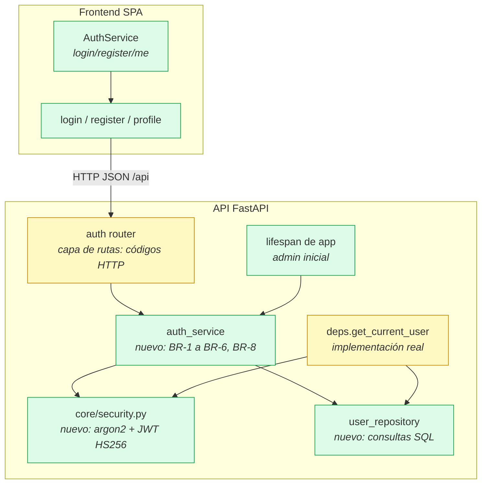

# Design

## Context

Ver `proposal.md` (Why / What Changes). Este cambio (feat-003, dueño **dev-a**) parte del esqueleto (feat-001) y del contrato (feat-002), ambos ya integrados:

- Tabla `users` creada por la migración `0001_create_users_and_books_tables.py`; enum `Role` en `app/models/user.py`; schemas `UserCreate` / `UserRead` en `app/schemas/user.py`.
- `app/api/deps.py` ya declara `get_current_user` (hoy un stub que devuelve 401) y `require_roles` (ya funcional); firma fijada por el contrato (docs/PRODUCT.md §6).
- Router `app/api/routes/auth.py` vacío pero registrado en `app/main.py`; rutas lazy `/login`, `/register` y `/profile` en `app.routes.ts` con componentes de plantilla.
- `core/auth/` trae `AuthService` (solo token en `localStorage`), `authInterceptor` (ya registrado en `app.config.ts`), `authGuard` y `roleGuard`.
- `app/core/config.py` ya expone `JWT_SECRET`, `JWT_EXPIRE_MINUTES`, `ADMIN_EMAIL` y `ADMIN_PASSWORD`; `.env.example` también.
- `pyproject.toml` ya declara `pyjwt[crypto]` y `pwdlib[argon2]`.
- ADR con estado Accepted: ADR 0001 (solo el proceso de ADR); ninguna regla de ADR condiciona este diseño.

Restricciones que moldean el enfoque: arquitectura por capas (routes → services → repositories → models), configuración solo por variables de entorno, sin cambios de esquema sin migración, y `./scripts/check.sh` en `CHECK OK` como evidencia.

## Goals / Non-Goals

**Goals:**
- Los 6 requisitos y 15 escenarios de `specs/authentication/spec.md` implementados: los 13 escenarios de API cubiertos por tests de pytest; los 2 de interfaz, con `ng build` y el smoke test de `./scripts/check.sh --full`.
- Los tres endpoints de auth operativos con los códigos y mensajes del contrato (docs/PRODUCT.md §6).
- Implementación real de `get_current_user` (necesaria para `GET /api/auth/me`), sin cambiar su firma.
- Arranque idempotente del admin inicial (BR-8).
- Páginas `/register`, `/login` y `/profile` con textos y errores en español.

**Non-Goals:**
- Guards de rutas de Angular, sesión al recargar la aplicación y cierre de sesión en la barra de navegación (feat-004).
- `GET /api/users` y `PATCH /api/users/{id}` (feat-005).
- Refresh tokens, recuperación de contraseña, login social (docs/PRODUCT.md §11).
- Cualquier cambio sobre `books` (dev-b) o sobre el enum `Role`.
- Migración de esquema: `users` ya existe tal cual la define el modelo (feat-002).

## Contratos

### API (coincide con docs/PRODUCT.md §6; mensajes de error en español)

| Método y ruta | Permiso | Request | Response 2xx | Errores |
|---|---|---|---|---|
| `POST /api/auth/register` | público | `{email, full_name, password}` | 201 `UserRead` (`id`, `email`, `full_name`, `role` = `reader`, `is_active`, `created_at`; nunca `password` ni `hashed_password`) | 409 `{"detail": "El email ya está registrado"}` · 422 validación (contraseña débil u email inválido) |
| `POST /api/auth/login` | público | `{email, password}` | 200 `{"access_token", "token_type": "bearer", "expires_in": 3600}` (`expires_in` = `JWT_EXPIRE_MINUTES * 60`) | 401 `{"detail": "Email o contraseña incorrectos"}` (igual para email inexistente y contraseña errónea) · 403 `{"detail": "La cuenta está desactivada"}` · 422 |
| `GET /api/auth/me` | autenticado (`Authorization: Bearer <token>`) | — | 200 `UserRead` (`email`, `full_name`, `role`, `is_active`, …) | 401 `{"detail": "No autenticado"}` (sin token, token inválido o vencido) · 403 `{"detail": "La cuenta está desactivada"}` |

Todas las respuestas de error usan el campo `detail`. Ninguna respuesta incluye `password` ni `hashed_password`.

### Datos

Sin cambios de esquema. `users`: `id`, `email` (único), `full_name`, `hashed_password` (argon2), `role` (`reader`/`librarian`/`admin`), `is_active`, `created_at` — ya migrado en `0001`. Único dato nuevo en la BD: el registro del admin inicial insertado por el arranque (BR-8), derivado de `ADMIN_EMAIL` / `ADMIN_PASSWORD`.

### Interfaz entre módulos (se mantiene; docs/PRODUCT.md §6)

- **Backend**: `app/api/deps.py` conserva las firmas `get_current_user(token, db) -> User` y `require_roles(*roles)`; este cambio reemplaza el stub de `get_current_user` por su implementación real (401 sin token/vencido, 403 si el usuario está inactivo). dev-b sigue sin tocarlo y sigue usando la fixture `auth_as(role)` en sus tests.
- **Frontend**: `AuthService` queda con `currentUser` (signal), `getToken()`, `setToken()`, `login()`, `register()`, `me()` y `logout()`; `authInterceptor` y los guards siguen intactos y ya registrados.

### Diagrama de contenedores

```mermaid
flowchart LR
  user([Usuario<br/>Navegador web])
  subgraph sys[Sistema: Gestión de Libros]
    spa[Frontend SPA<br/><i>Angular 19 + Nginx</i><br/>Registro, login y perfil]
    api[API REST<br/><i>FastAPI</i><br/>Auth JWT y reglas BR-1 a BR-8]
    db[(Base de datos<br/><i>PostgreSQL 16</i><br/>Tabla users)]
  end
  user -->|HTTP| spa
  spa -->|JSON /api/auth| api
  api -->|SQL vía SQLAlchemy| db
  classDef new fill:#dcfce7,stroke:#16a34a
  classDef modified fill:#fef9c3,stroke:#ca8a04
  classDef unchanged fill:#e5e7eb,stroke:#6b7280
  class spa modified, api modified, db unchanged
```

### Diagrama de componentes (capas de auth)



## Decisions

**D1. Servicio y repositorio nuevos para auth.**
Se crean `app/services/auth_service.py` (toda la lógica de negocio: BR-1 a BR-6, BR-8) y `app/repositories/user_repository.py` (única capa que consulta `users`: `get_by_email`, `exists_admin`, `add`), más `app/core/security.py` para hash y tokens.
*Alternativa descartada*: poner la lógica en `app/api/routes/auth.py` — rompe la arquitectura de capas (las rutas solo validan entrada/salida y devuelven códigos).

**D2. Hash y token en `app/core/security.py`.**
`pwdlib[argon2]` (Argon2id) para hash/verificación de contraseñas y `PyJWT` con HS256 para el token, con claims `sub` (id de usuario), `iat` y `exp = iat + JWT_EXPIRE_MINUTES`. `expires_in = JWT_EXPIRE_MINUTES * 60`.
Para que el 401 del login tarde lo mismo exista o no el email, la verificación contra un email inexistente se hace contra un hash argon2 fijo de referencia (mitiga la enumeración de usuarios).
*Alternativas descartadas*: `passlib` (proyecto sin mantenimiento); PBKDF2/bcrypt (el stack fija argon2 en AGENTS.md y BR-3); cookie `httpOnly` en lugar de Bearer (exige cambios de nginx/CORS fuera de este cambio).

**D3. `get_current_user` se implementa ahora, no en feat-004.**
La spec exige que `GET /api/auth/me` devuelva 200 con token válido y 401 sin token o con token vencido; sin un `get_current_user` real ese escenario es imposible. Se reemplaza el stub de `deps.py` por: decodificar el token → cargar el usuario por id → 401 `"No autenticado"` si el token es inválido/vencido o el usuario no existe → 403 `"La cuenta está desactivada"` si `is_active` es falso (BR-6 y la semántica 401/403 de docs/PRODUCT.md §6). La firma no cambia, así que dev-b no se entera.
*Alternativa descartada*: dejar el stub hasta feat-004 — incumple la spec de este cambio.
*Nota de coordinación*: la descripción de feat-004 en `feature_list.json` ("implementación real de get_current_user y require_roles") queda entonces parcialmente cubierta aquí; en feat-004 solo quedan los guards de Angular y la sesión persistente. Al empezar feat-003 se ajusta esa descripción para evitar trabajo duplicado.

**D4. Contraseña débil → 422 desde Pydantic.**
La regla de complejidad (≥8 caracteres, una letra y un número, BR-2) vive en un validador del schema de registro, de modo que FastAPI devuelve 422 con `detail` en español ("la contraseña necesita al menos 8 caracteres, una letra y un número") sin código de negocio en la ruta.
*Alternativa descartada*: excepción 400/401 lanzada desde el servicio — el contrato fija 422.

**D5. El campo `role` del registro se ignora.**
`UserCreate` (feat-002) no incluye `role` y Pydantic v2 ignora los campos extra por defecto; el rol nace del `default` del modelo (`reader`, BR-5). Se cubre con un test que envía `role: "admin"` y verifica que la cuenta queda `reader`.
*Alternativa descartada*: rechazar la petición con 422 — la spec pide explícitamente ignorar el campo.

**D6. Los errores de negocio son excepciones de dominio, traducidas en la ruta.**
`auth_service` define `EmailAlreadyRegisteredError`, `InvalidCredentialsError` y `AccountDisabledError` (sin importar FastAPI, como exige la arquitectura); la capa de rutas las captura y las traduce en `HTTPException(409, "El email ya está registrado")`, `401 "Email o contraseña incorrectos"` y `403 "La cuenta está desactivada"` (BR-1, BR-4, BR-6). El repositorio comprueba `get_by_email` antes de insertar y la `IntegrityError` residual de la carrera también se envuelve en `EmailAlreadyRegisteredError`.
*Alternativas descartadas*: `HTTPException` dentro del servicio (el servicio conocería el framework web); dejar que falle el `unique` de la BD → error 500, fuera del contrato.

**D7. Admin inicial en el `lifespan` de FastAPI.**
`ensure_initial_admin()` en `auth_service` se ejecuta al arrancar la app: si no existe ningún usuario con `role = admin`, crea el de `ADMIN_EMAIL` con `ADMIN_PASSWORD` hasheada e `is_active = true`; si ya existe, no hace nada (idempotente, BR-8). El `lifespan` resuelve la sesión con `app.dependency_overrides.get(get_db)` cuando existe, para que los tests (SQLite en memoria, `conftest.py`) arranquen igual sin tocar PostgreSQL.
El registro es `app = FastAPI(..., lifespan=lifespan)` en `app/main.py`.
*Archivos compartidos*: solo `backend/app/main.py` (una línea más un import) — cambio mínimo que entra en el Pull Request y lo revisa dev-b; no se tocan `app/models/__init__.py`, `alembic/versions/`, `tests/conftest.py`, `app.routes.ts`, `app.config.ts`, `docker-compose*.yml` ni `.env.example` (las variables ya existen).
*Alternativas descartadas*: script de seed manual (la spec dice "cuando la API arranca"); migración de datos de Alembic (los valores dependen del entorno); `@app.on_event("startup")` (API deprecada desde FastAPI 0.93).

**D8. Frontend con `HttpClient` y formularios reactivos.**
`AuthService` gana `login()`, `register()` y `me()`, que llaman a rutas relativas `/api/auth/...` (nunca `http://localhost:8000`), guardan el token en `localStorage` bajo la clave `token` (la que ya lee `authInterceptor`) y actualizan `currentUser`. Los tres componentes usan `ReactiveFormsModule` (`@angular/forms` ya está en `package.json`), muestran el `detail` del 401/409/422 en español sin recargar y, tras un login correcto, navegan a `/books`. Ante un 401 en `/profile`, el componente hace `logout()` y navega a `/login`.
*Alternativa descartada*: formularios basados en plantilla — menos testeables y ya no son la práctica en standalone components con signals.
*Dependencias*: una nueva en el backend — `email-validator` (extra `pydantic[email]`), que el contrato de feat-002 ya exigía al usar `EmailStr` en `app/schemas/user.py` sin declararla: sin ella, la app falla al importar cualquier schema de usuario (bug latente detectado en la tarea 3.1). `pyjwt` y `pwdlib[argon2]` ya estaban declaradas; en el frontend, sin cambios.

**D10. El email acepta los dominios special-use del contrato (`.local`).**
`PRODUCT.md` §7 define `ADMIN_EMAIL=admin@library.local` y BR-8 exige que ese admin pueda iniciar sesión, pero `EmailStr` (email-validator 2.x) rechaza `.local`/`.invalid` sin excepción: el login del admin devolvía 422 y `GET /api/auth/me` del admin fallaba al serializar `UserRead`. Por eso `app/schemas/user.py` define `EmailField` (valida con `email-validator` y, si el fallo es de dominio y tiene forma `local@dominio.tld`, lo acepta con el dominio en minúsculas) y lo usan `UserBase.email` y `LoginRequest.email`; los emails malformados siguen siendo 422. `app/schemas/user.py` es un archivo creado por feat-002: se toca aquí porque el escenario BR-8 lo exige, y dev-b lo revisa en el PR.
*Alternativa descartada*: cambiar `.env.example`/`PRODUCT.md` a `admin@example.com` — el contrato ya está escrito y cambiarlo afecta a las dos máquinas y a la EC2 desplegada.

**D9. La protección de rutas se deja para feat-004.**
`app.routes.ts` (compartido) no se modifica: no se agrega `canActivate` a `/profile` en este cambio. El componente maneja el 401 por sí mismo (D8). Los guards y la sesión persistente son feat-004, dueño de esos archivos.
*Alternativa descartada*: agregar `canActivate: [authGuard]` ahora — toca un archivo compartido sin necesidad y duplica el alcance de feat-004.

## Risks / Trade-offs

- **Token en `localStorage` expuesto a XSS** → Angular escapa todos los bindings y no hay `innerHTML` con datos de usuario en este cambio; se acepta por simplicidad en v1. Si en el futuro se mueve a cookie `httpOnly`, abrir un ADR (afecta a interceptor, guards y nginx).
- **El arranque depende de la BD**: si PostgreSQL no está disponible, `ensure_initial_admin` no crea el admin (la API sigue sirviendo y el próximo arranque reintenta). Se cubre con `./scripts/check.sh --full` antes de integrar.
- **`app/main.py` es compartido**: el riesgo de conflicto de merge con dev-b se minimiza al tocar solo el `FastAPI(...)`; el PR lo revisa dev-b (regla de archivos compartidos).
- **Solape de alcance con feat-004** (D3): sin la nota de coordinación, feat-004 podría reimplementar `get_current_user`. Se ajusta `feature_list.json` al empezar la implementación.
- **Contraseña del admin por defecto** (`Admin12345` en `config.py` y `.env.example`): es un valor de ejemplo local; en producción la genera `infra/terraform/user-data.sh`. Nunca subir un `.env` real.
- **Costo de argon2**: ~50-100 ms por hash; suficiente para el volumen previsto (una EC2 t3.micro) y es el precio de BR-3/RNF-01.

## Migration Plan

1. **Despliegue**: sin migración de esquema (la tabla `users` ya existe desde feat-002; `alembic heads` sigue con un solo head). El cambio se integra a `develop` por PR con `./scripts/check.sh` en verde y llega a producción con el flujo normal (`release/*` → `main`).
2. **Primer arranque en producción**: el lifespan crea el admin inicial con `ADMIN_EMAIL`/`ADMIN_PASSWORD` del `.env` de la EC2; verificar con un `POST /api/auth/login` de ese admin (evidencia en el smoke test).
3. **Rollback**: revert del PR (los tres endpoints y las páginas desaparecen; no queda esquema que revertir). Si además se quiere eliminar el admin creado, basta con `DELETE FROM users WHERE email = <ADMIN_EMAIL>;` — la tabla no se modifica.

## Open Questions

Ninguna: todos los puntos abiertos de este alcance (semántica de `get_current_user`, momento del seed de admin y protección de `/profile`) se resuelven en D3, D7 y D9 sin tocar los specs ni el desglose de tareas.
