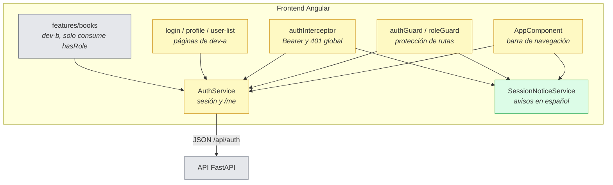

# Design

## Context

Ver `proposal.md` (Why / What Changes). Este cambio (feat-004, dueño **dev-a**) parte de feat-003 ya integrado en `develop`:

- `app/api/deps.py` ya tiene la implementación real de `get_current_user` (401 sin token, token inválido o vencido; 403 `"La cuenta está desactivada"`) y `require_roles(*roles)` (403 `"No tienes permiso para esta acción"`). Se implementaron en feat-003 (D3 de su design) porque `GET /api/auth/me` las necesitaba; feat-004 **no cambia sus firmas**.
- `app/api/routes/books.py` ya usa ambas dependencias (dev-b); `app/api/routes/users.py` está vacío a la espera de feat-005.
- `frontend/src/app/core/auth/` trae `AuthService` (token en `localStorage`, `currentUser` signal, `login()`, `register()`, `me()`, `logout()`, `hasRole(role: string)`), `authInterceptor` registrado en `app.config.ts`, y guards esqueleto (`authGuard` solo mira el token; `roleGuard` mira `currentUser` sin restaurar sesión).
- `app.routes.ts` no tiene ningún guard aplicado; `app.component.ts` muestra siempre los mismos enlaces (Inicio, Libros, Usuarios, Iniciar sesión) y no ofrece cerrar sesión.
- `AuthService` no restaura la sesión al recargar: `currentUser` queda `null` aunque haya token, así que `hasRole()` y los botones de dev-b no funcionan tras un refresh.
- `docs/TESTING.md`: el sensor obligatorio del frontend es `npx ng build`; los tests unitarios de Angular son opcionales y hoy no hay target de test ni `test:ci`.
- ADR aceptados: solo ADR 0001 (proceso de ADR); ninguna regla condiciona este diseño.

Restricciones que moldean el enfoque: la autorización de la API ya existe y no debe duplicarse; los archivos `app.routes.ts` y `app.config.ts` son compartidos y los revisa dev-b; `./scripts/check.sh` debe terminar en `CHECK OK`.

## Goals / Non-Goals

**Goals:**
- Los 5 requisitos y 12 escenarios de `specs/authorization/spec.md`: los 8 de API cubiertos con pytest; los 4 de interfaz verificados con `ng build`, `./scripts/check.sh --full` y una comprobación manual documentada (no hay infraestructura de tests de Angular).
- Demostrar con tests que cada ruta protegida del contrato responde 401/403 según corresponda, sin cambiar la firma de `get_current_user` ni de `require_roles`.
- Sesión persistente al recargar, guards aplicados a las rutas de `docs/PRODUCT.md` §7, manejo global del 401 y cierre de sesión desde la barra de navegación.

**Non-Goals:**
- Administración de usuarios completa (`GET /api/users` con búsqueda/paginación y `PATCH /api/users/{id}`): feat-005. Aquí solo se añade la protección mínima de `GET /api/users` que exige el escenario de 403.
- Cambiar los componentes de libros de dev-b (`canManageBooks()` ya consume `hasRole()` y seguirá funcionando).
- Refresh tokens, cookies `httpOnly`, expiración deslizante o permisos por recurso (docs/PRODUCT.md §11).
- Introducir Vitest o un target de tests de Angular: no hay infraestructura y `docs/TESTING.md` lo considera opcional; crearla merece un cambio propio.
- Cambios de esquema, migraciones o variables de entorno nuevas.

## Contratos

### API (coincide con docs/PRODUCT.md §3 y §6)

No hay endpoints nuevos de negocio. La autorización se aplica así:

| Método y ruta | Permiso | Sin token / token inválido | Rol insuficiente |
|---|---|---|---|
| `GET /api/auth/me` | autenticado | 401 `"No autenticado"` | — |
| `GET /api/books`, `GET /api/books/genres`, `GET /api/books/{id}` | autenticado | 401 `"No autenticado"` | — |
| `POST /api/books`, `PUT /api/books/{id}`, `DELETE /api/books/{id}` | librarian, admin | 401 `"No autenticado"` | 403 `"No tienes permiso para esta acción"` |
| `GET /api/users` | admin | 401 `"No autenticado"` | 403 `"No tienes permiso para esta acción"` |
| Cualquier ruta protegida con token de cuenta desactivada | — | — | 403 `"La cuenta está desactivada"` |

`GET /api/users` en este cambio devuelve a un admin `{"items": [], "total": 0, "page": 1, "size": 10}` como marcador temporal; feat-005 sustituye el handler por el listado real con `q`, `page` y `size`. El objetivo aquí es que la dependencia `require_roles(Role.admin)` se ejecute y el escenario de 403 sea observable y testeable.

### Interfaz entre módulos (frontend; mantiene lo que usa dev-b)

```ts
type UserRole = 'reader' | 'librarian' | 'admin';

AuthService:
  currentUser: Signal<UserProfile | null>
  isAuthenticated(): boolean                 // token presente y currentUser cargado
  hasRole(role: UserRole): boolean            // firma compatible con dev-b
  restoreSession(): Promise<void>             // /me si hay token; limpia si falla
  login(email, password): Observable<UserProfile>
  logout(): void                              // borra token, currentUser y aviso
  getToken(): string | null
  setToken(token: string): void

SessionNoticeService:
  message: Signal<string | null>
  show(message: string): void
  clear(): void

authGuard: CanActivateFn                      // sin sesión -> /login
roleGuard(roles: UserRole[]): CanActivateFn   // rol no permitido -> /books + aviso
authInterceptor: HttpInterceptorFn            // Bearer + 401 global
```

Comportamiento observable de las rutas (`app.routes.ts`):

| Ruta | Guards |
|---|---|
| `/`, `/login`, `/register` | ninguno |
| `/profile`, `/books`, `/books/:id` | `authGuard` |
| `/books/new`, `/books/:id/edit` | `authGuard`, `roleGuard(['librarian','admin'])` |
| `/users` | `authGuard`, `roleGuard(['admin'])` |

### Datos

Sin cambios de esquema ni migración. Solo se lee `users.is_active` y `users.role` para autorizar.

### Archivos que toca el cambio y dueño

| Archivo | Dueño | Nota |
|---|---|---|
| `backend/tests/test_authorization.py` | dev-a | nuevo; cubre los 8 escenarios de API |
| `backend/app/api/routes/users.py` | dev-a | solo el `GET ""` protegido temporal; feat-005 lo completa |
| `backend/app/api/deps.py` | dev-a | se revisa; no se espera cambio funcional |
| `frontend/src/app/core/auth/auth.service.ts` | dev-a | restauración de sesión, `isAuthenticated()`, `hasRole` tipado |
| `frontend/src/app/core/auth/auth.guard.ts` | dev-a | exige sesión restaurada |
| `frontend/src/app/core/auth/role.guard.ts` | dev-a | roles tipados + aviso |
| `frontend/src/app/core/auth/auth.interceptor.ts` | dev-a | manejo global del 401 |
| `frontend/src/app/core/auth/auth-notice.service.ts` | dev-a | nuevo; aviso global de sesión/permiso |
| `frontend/src/app/features/auth/login/login.component.ts` | dev-a | limpia el aviso al iniciar sesión |
| `frontend/src/app/app.component.ts` | dev-a | navegación por sesión/rol y botón "Cerrar sesión" |
| `frontend/src/app/app.routes.ts` | **compartido** | guards aplicados; PR revisado por dev-b |
| `frontend/src/app/app.config.ts` | **compartido** | `provideAppInitializer` para restaurar la sesión; PR revisado por dev-b |

No se tocan archivos de dev-b (`features/books/**`, `core/books/**`, `routes/books.py`) ni `tests/conftest.py`, `app/main.py`, `app/models/**` o `alembic/**`.

### Diagrama de contenedores

```mermaid
flowchart LR
  user([Usuario<br/>Navegador web])
  subgraph sys[Sistema: Gestión de Libros]
    spa[Frontend SPA<br/><i>Angular 19 + Nginx</i><br/>Guards, sesión persistente y barra de navegación]
    api[API REST<br/><i>FastAPI</i><br/>get_current_user y require_roles]
    db[(Base de datos<br/><i>PostgreSQL 16</i><br/>users.role y users.is_active)]
  end
  user -->|HTTP| spa
  spa -->|JSON /api con Bearer| api
  api -->|SQL vía SQLAlchemy| db
  classDef modified fill:#fef9c3,stroke:#ca8a04
  classDef unchanged fill:#e5e7eb,stroke:#6b7280
  class spa modified, api unchanged, db unchanged
```

### Diagrama de componentes (auth de la SPA)



## Decisions

**D1. La autorización de la API se valida, no se reimplementa.**
`get_current_user` y `require_roles` ya cumplen los mensajes y códigos de la spec desde feat-003; este cambio agrega `tests/test_authorization.py` con tokens reales (registro → login → Bearer), tokens alterados/vencidos y usuarios desactivados. No se duplica lógica ni se cambia la firma que consume dev-b.
*Alternativa descartada*: reescribir `deps.py` en feat-004 — desperdicia trabajo, duplica el alcance ya cerrado y arriesga romper los tests de dev-b.

**D2. `GET /api/users` mínimo y protegido para poder observar el 403.**
La spec de este cambio exige que un `librarian` reciba 403 en `GET /api/users`, pero el router está vacío hasta feat-005 (una ruta inexistente devolvería 404 antes de evaluar dependencias). Se añade un handler temporal con `Depends(require_roles(Role.admin))` que responde la forma paginada vacía del contrato; feat-005 lo reemplaza por el listado real.
*Alternativa descartada*: mover el escenario a feat-005 — dejaría un escenario de feat-004 sin cubrir en `/opsx-verify`; se documenta el marcador para que no se confunda con la implementación completa.

**D3. Restaurar la sesión al arrancar con `provideAppInitializer` + `/me`.**
`AuthService.restoreSession()` lee el token de `localStorage`; si no existe deja `currentUser` en `null`; si existe llama a `/api/auth/me`, guarda el perfil en el signal y, ante cualquier error, borra el token. `app.config.ts` registra `provideAppInitializer(() => inject(AuthService).restoreSession())`, de modo que los guards y los componentes de dev-b encuentran `currentUser` resuelto antes de la primera navegación.
*Alternativas descartadas*: decodificar `exp` en el cliente (no valida la firma ni detecta cuentas desactivadas); llamar a `/me` desde cada guard (multiplica peticiones y parpadeos); restaurar en `AppComponent.ngOnInit` (corre después del primer guard y provoca redirecciones falsas).

**D4. Guards compuestos y redirección fija según la spec.**
`authGuard` exige `isAuthenticated()` (token + `currentUser`); si falla, devuelve `router.parseUrl('/login')`. `roleGuard(roles)` asume que `authGuard` ya pasó y, si el rol no está permitido, llama a `SessionNoticeService.show('No tienes permiso para esta acción')` y devuelve `parseUrl('/books')`. Las rutas se declaran con `canActivate: [authGuard, roleGuard(...)]`; Angular evalúa en orden.
*Alternativas descartadas*: un único guard que reciba `{auth, roles}` (menos legible y cambia la interfaz que ya usa dev-b); redirigir a `/` (la spec fija `/books`).

**D5. Aviso global con un servicio de signals, sin tocar componentes de dev-b.**
`SessionNoticeService` guarda un mensaje efímero; `AppComponent` lo pinta como banner en cualquier página. El 401 del interceptor muestra `"Tu sesión expiró"` y el `roleGuard` muestra `"No tienes permiso para esta acción"`. Así la página de destino (`/login` o `/books`) no necesita conocer el motivo.
*Alternativas descartadas*: query params (`?error=...`) — ensucian la URL y obligan a leerlos en cada página; modificar `book-list` de dev-b para mostrar el aviso — viola la propiedad de archivos.

**D6. El interceptor maneja el 401 global, salvo login y la restauración.**
`authInterceptor` agrega `Authorization: Bearer <token>` cuando hay token y, con `catchError`, ante un 401 (excepto `POST /api/auth/login`, que usa 401 para credenciales incorrectas, y la llamada de `restoreSession`) ejecuta `logout()`, muestra `"Tu sesión expiró"` y navega a `/login`. Se distingue la restauración con un `HttpContextToken` (`SKIP_SESSION_REDIRECT`) para no navegar durante el arranque.
*Alternativas descartadas*: excluir solo por URL (frágil y no distingue usos de `/me`); manejar el 401 en cada componente (duplicación y olvidos).

**D7. `hasRole` conserva su firma; no se rompe a dev-b.**
Se tipa el parámetro como `UserRole` y se conserva `hasRole(role)`; se añade `hasAnyRole(...roles)` para uso interno. `book-list` y `book-detail` siguen llamando `hasRole('librarian')`/`hasRole('admin')` sin cambios.
*Alternativa descartada*: convertir `hasRole` en variádico — cambiaría el contrato de la interfaz que dev-b ya consume.

**D8. Cambios en la barra de navegación dentro de `AppComponent`.**
La barra usa los signals de `AuthService` para mostrar Inicio y Libros siempre, Usuarios solo con rol `admin`, el perfil y "Cerrar sesión" cuando hay sesión, e "Iniciar sesión" cuando no la hay. "Cerrar sesión" llama `logout()` y navega a `/login`.
*Alternativa descartada*: crear un componente de menú compartido — innecesario para cuatro enlaces y añade superficie de cambio.

**D9. Sin infraestructura nueva de tests de Angular.**
Los 8 escenarios de API se cubren con pytest. Los 4 de interfaz (redirección sin sesión, redirección por rol con aviso, 401 durante el uso, cierre de sesión y botón "atrás") se verifican con `npx ng build`, `./scripts/check.sh --full` y una comprobación manual en el navegador cuyo resultado se registra como evidencia. `docs/TESTING.md` permite tests de frontend opcionales y hoy no hay target ni `test:ci`.
*Alternativa descartada*: añadir Vitest y un target de pruebas en este cambio — infraestructura nueva fuera del alcance de autorización; merece su propio cambio.

**D10. Archivos compartidos con revisión de dev-b.**
`app.routes.ts` y `app.config.ts` son los únicos archivos compartidos que se tocan; el PR los marca explícitamente para que dev-b los revise. No se tocan `app/main.py`, `tests/conftest.py`, `app/models/__init__.py`, migraciones, `docker-compose*.yml` ni `.env.example`.
*Alternativa descartada*: dejar los guards fuera de `app.routes.ts` — imposible cumplir RF-06 sin registrar `canActivate`.

## Risks / Trade-offs

- **`provideAppInitializer` bloquea el arranque si la API tarda o no responde** → `restoreSession` convierte cualquier error en sesión vacía y resuelve; el usuario llega a `/login`. Si la API cuelga, el navegador corta por su timeout. Se verifica con `./scripts/check.sh --full`.
- **Bucles de redirección del interceptor** → se excluyen `POST /api/auth/login` y la restauración con `HttpContextToken`; solo se navega si había token.
- **El marcador `GET /api/users` puede parecer funcionalidad terminada** → responde siempre vacío, la tarea lo marca como temporal y feat-005 lo sustituye de inmediato.
- **`currentUser` desactualizado tras un cambio de rol** (feat-005) → los botones de la interfaz cambian al recargar; la API ya aplica el rol nuevo en la siguiente petición. Se acepta en v1; refrescar en cada navegación añadiría una petición por ruta.
- **Conflicto de merge en `app.routes.ts` / `app.config.ts`** → cambios pequeños y localizados, PR revisado por dev-b según la tabla de dueños.
- **Token en `localStorage` expuesto a XSS** → riesgo ya aceptado en feat-003 (D8); este cambio no añade superficies nuevas de HTML dinámico.
- **Sin tests automáticos de la SPA** → los escenarios de interfaz dependen de verificación manual; se mitiga con pasos reproducibles en `tasks.md` y evidencia en `feature_list.json`.

## Migration Plan

1. **Despliegue**: sin migración de esquema ni variables nuevas. El backend añade solo tests y el handler temporal de `users`; la SPA publica guards, restauración de sesión y barra de navegación. Se integra a `develop` por PR con `./scripts/check.sh` en verde; llega a producción con el flujo `release/*` → `main`.
2. **Verificación posterior**: con `./scripts/check.sh --full` (smoke de salud, SPA y fallback) y una sesión real (login, recarga, acceso a `/users` como reader → aviso, logout, botón "atrás" → `/login`).
3. **Rollback**: revert del PR. No hay estado persistido que deshacer; los usuarios y tokens siguen siendo válidos y la API de libros vuelve a su comportamiento anterior (la autorización de la API no cambia, porque ya existía).

## Open Questions

Ninguna: el alcance del marcador de `users` (D2), la restauración de sesión (D3), el aviso de permisos (D5) y los archivos compartidos (D10) quedan resueltos sin tocar los specs.
