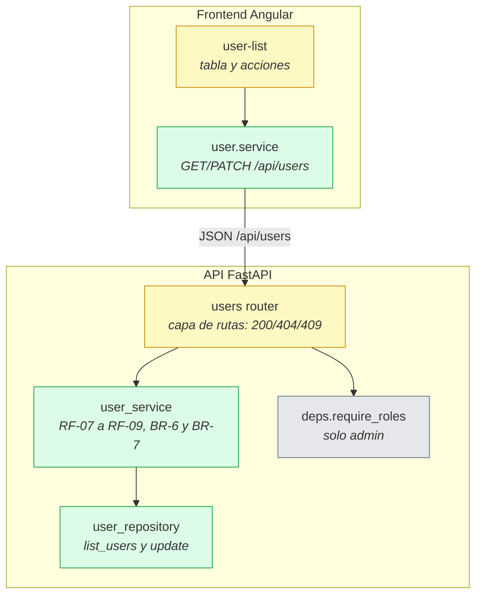

# Design

## Context

Ver `proposal.md` (Why / What Changes). Este cambio (feat-005, dueño **dev-a**) parte de feat-004 ya integrado en `develop`:

- `GET /api/users` existe solo como marcador protegido con `require_roles(Role.admin)` en `app/api/routes/users.py`; devuelve `{"items": [], "total": 0, "page": 1, "size": 10}`.
- `UserRepository` solo tiene `get_by_email`, `get_by_id`, `exists_admin` y `add`; no hay consultas paginadas ni actualización.
- `app/schemas/user.py` tiene `UserBase`, `UserCreate` y `UserRead`; no hay schema de actualización ni de página.
- `app/services/auth_service.py` ya sigue el patrón de excepciones de dominio traducidas en la ruta; `book_service` usa `HTTPException` directamente.
- `frontend/src/app/features/users/user-list/user-list.component.ts` es un componente vacío; la ruta `/users` ya está protegida con `authGuard` y `roleGuard(['admin'])` desde feat-004.
- `AuthService.currentUser()` permite conocer el admin actual y evitar depender de ids adivinados en la interfaz.
- No hay target de tests de Angular; el sensor del frontend es `npx ng build` (ver `docs/TESTING.md`).
- ADR aceptados: solo ADR 0001 (proceso de ADR); ninguna regla condiciona este diseño.

Restricciones: arquitectura por capas (routes → services → repositories → models), respuestas con `detail` en español, sin migraciones ni dependencias nuevas, y `./scripts/check.sh` en `CHECK OK`.

## Goals / Non-Goals

**Goals:**
- Implementar los 5 requisitos y 11 escenarios de `specs/user-administration/spec.md`: 9 de API cubiertos con pytest y 2 de interfaz verificados con `ng build` y una comprobación manual en Chromium.
- Listado paginado con búsqueda por email o nombre, cambio de rol y activación/desactivación, todo solo para `admin`.
- Cumplir BR-6 (token de cuenta desactivada → 403 "La cuenta está desactivada") y BR-7 (el admin no puede quitarse su rol ni desactivarse) con mensajes exactos.

**Non-Goals:**
- Crear o eliminar usuarios, cambiar email o contraseña (fuera de alcance del proposal).
- Cambiar el contrato de `get_current_user`/`require_roles` ni las rutas de libros.
- Paginación por cursor, filtros adicionales, auditoría o notificaciones por email.
- Infraestructura de tests de Angular (sigue siendo opcional en `docs/TESTING.md`).
- Cambios de esquema, migraciones, variables de entorno o dependencias.

## Contratos

### API (coincide con docs/PRODUCT.md §6)

| Método y ruta | Permiso | Request | Response 2xx | Errores |
|---|---|---|---|---|
| `GET /api/users?q=&page=&size=` | admin | `q` opcional; `page >= 1`; `size` entre 1 y 50 (por defecto 10) | 200 `{items: UserRead[], total, page, size}`; `items` ordenado por `id` | 401 `"No autenticado"` · 403 `"No tienes permiso para esta acción"` · 422 parámetros inválidos |
| `PATCH /api/users/{id}` | admin | `{role?: "reader"\|"librarian"\|"admin", is_active?: boolean}`; al menos uno de los dos | 200 `UserRead` actualizado | 401 · 403 · 404 `"Usuario no encontrado"` · 409 BR-7 · 422 rol inexistente |

BR-7 (solo cuando el destino es el propio admin):
- `role` distinto de `admin` → 409 `"No puedes quitarte tu propio rol de administrador"`.
- `is_active: false` → 409 `"No puedes desactivar tu propia cuenta"`.

`UserRead` conserva el contrato de feat-002: `id`, `email`, `full_name`, `role`, `is_active`, `created_at`; nunca `hashed_password`.

### Interfaz entre módulos (frontend)

```ts
// frontend/src/app/features/users/user.service.ts
interface AdminUser {
  id: number;
  email: string;
  full_name: string;
  role: UserRole;
  is_active: boolean;
  created_at: string;
}
interface PaginatedUsers { items: AdminUser[]; total: number; page: number; size: number; }

UserService:
  list(q: string, page: number, size: number): Observable<PaginatedUsers>
  update(id: number, changes: { role?: UserRole; is_active?: boolean }): Observable<AdminUser>
```

La página `/users` usa el `UserService`, `AuthService.currentUser()` para identificar la fila propia y los textos/errores en español. No cambia `app.routes.ts` porque el guard admin ya existe.

### Datos

Sin cambios de esquema. Se leen y actualizan `users.role` y `users.is_active`; `email`, `full_name`, `hashed_password` y `created_at` no se modifican.

### Archivos que toca el cambio y dueño

| Archivo | Dueño | Nota |
|---|---|---|
| `backend/app/repositories/user_repository.py` | dev-a | `list_users` y `update` |
| `backend/app/schemas/user.py` | dev-a | `UserUpdate` y `PaginatedUsersResponse` |
| `backend/app/services/user_service.py` | dev-a | nuevo; lógica y excepciones de dominio |
| `backend/app/api/routes/users.py` | dev-a | reemplaza el marcador por `GET` y `PATCH` reales |
| `backend/tests/test_users.py` | dev-a | nuevo; 9 escenarios de API |
| `backend/tests/test_authorization.py` | dev-a | ajusta la expectativa vacía del marcador de `GET /api/users` |
| `frontend/src/app/features/users/user.service.ts` | dev-a | nuevo; servicio HTTP dentro de la carpeta de la feature |
| `frontend/src/app/features/users/user-list/user-list.component.ts` | dev-a | tabla, buscador, rol y estado |
| `feature_list.json`, `progress/dev-a.md` | dev-a | estado y evidencia |

No se tocan archivos compartidos ni de dev-b (`app.routes.ts`, `app.config.ts`, `tests/conftest.py`, `app/main.py`, `app/models/**`, `alembic/**`, `features/books/**`).

### Diagrama de contenedores

```mermaid
flowchart LR
  admin([Admin<br/>Navegador web])
  subgraph sys[Sistema: Gestión de Libros]
    spa[Frontend SPA<br/><i>Angular 19 + Nginx</i><br/>Página /users con tabla, buscador, rol y estado]
    api[API REST<br/><i>FastAPI</i><br/>GET/PATCH /api/users solo admin]
    db[(Base de datos<br/><i>PostgreSQL 16</i><br/>users.role e is_active)]
  end
  admin -->|HTTP| spa
  spa -->|JSON /api/users con Bearer| api
  api -->|SQL vía SQLAlchemy| db
  classDef new fill:#dcfce7,stroke:#16a34a
  classDef modified fill:#fef9c3,stroke:#ca8a04
  class spa modified, api modified, db unchanged
```

### Diagrama de componentes (capa de usuarios)



## Decisions

**D1. Consultas en `UserRepository`, reglas en `user_service` y códigos en la ruta.**
El repositorio añade `list_users(db, q, page, size)` (filtro `ilike` sobre `email` y `full_name`, `offset/limit`, `count`) y `update(db, user, data)` (commit y refresh). El servicio decide la búsqueda, la paginación y BR-7; la ruta solo valida parámetros, traduce excepciones y devuelve `UserRead`.
*Alternativa descartada*: consultar y mutar desde la ruta — rompe las capas y duplica el patrón que ya usan auth y books.

**D2. Excepciones de dominio traducidas en la ruta (como `auth_service`).**
`UserNotFoundError`, `SelfRoleRemovalError` y `SelfDeactivationError` viven en el servicio; la ruta las convierte en 404/409 con los mensajes exactos de la spec. El servicio no importa FastAPI.
*Alternativa descartada*: lanzar `HTTPException` desde el servicio (patrón de `book_service`): mezcla framework y negocio; para un módulo nuevo conviene el patrón correcto de `auth_service`.

**D3. `UserUpdate` con campos opcionales y validación de rol por Pydantic.**
`role: Role | None` e `is_active: bool | None`; la ruta usa `model_dump(exclude_unset=True, exclude_none=True)`. Un `role` inválido (`superuser`) lo rechaza Pydantic con 422 antes de tocar la BD.
*Alternativa descartada*: recibir `role` como `str` y validarlo a mano en la ruta — duplica lo que el enum ya garantiza.

**D4. BR-7 se evalúa con el id del usuario autenticado.**
Si `target_id == current_user.id`: un `role` distinto de `admin` lanza `SelfRoleRemovalError`; `is_active` en falso lanza `SelfDeactivationError`. No se prohíbe que un admin desactive a otro admin (la regla solo protege la propia cuenta).
*Alternativa descartada*: comprobar el email o consultar de nuevo al usuario actual — el id del token ya es la fuente de verdad.

**D5. Paginación idéntica a libros y búsqueda insensible a mayúsculas.**
Respuesta `{items, total, page, size}`; `page >= 1` y `size` entre 1 y 50 con 10 por defecto; `q` se aplica con `ilike` a `email` y `full_name` y los resultados se ordenan por `id`.
*Alternativa descartada*: cursor o búsqueda exacta — el contrato y la interfaz esperan el mismo formato que `GET /api/books`.

**D6. El servicio HTTP del frontend vive en `features/users/`.**
`user.service.ts` se coloca junto a la página para respetar la propiedad de archivos de dev-a (`frontend/src/app/features/users/**`); `core/users/**` no figura en la tabla de dueños.
*Alternativa descartada*: `core/users/user.service.ts` — más coherente con `core/books`, pero introduce una ruta no asignada que requeriría revisión compartida.

**D7. Actualización local tras `PATCH`, con recarga solo si falla.**
Al cambiar el rol, la respuesta actualiza la fila del signal y se muestra "Rol actualizado". Si el `PATCH` falla (por ejemplo BR-7), se muestra el `detail` en español y se recarga el listado para que el selector o el interruptor vuelvan a su estado real; el interruptor también se revierte de inmediato con el `checked` del usuario.
*Alternativa descartada*: recargar toda la tabla después de cada cambio — más peticiones y parpadeos innecesarios en el caso feliz.

**D8. La ruta `/users` no se toca.**
El guard `authGuard` + `roleGuard(['admin'])` ya está registrado en feat-004; este cambio solo rellena el componente. Así se evita tocar un archivo compartido.
*Alternativa descartada*: volver a editar `app.routes.ts` — trabajo duplicado y riesgo de conflicto.

**D9. Sin infraestructura nueva de tests de Angular.**
Los 9 escenarios de API se cubren con pytest; los 2 de interfaz se verifican con `ng build` y una comprobación manual documentada (cambio de rol con "Rol actualizado" y error BR-7 con el interruptor revertido).
*Alternativa descartada*: añadir Vitest en este cambio — fuera del alcance de administración de usuarios.

**D10. Sin migración ni dependencias nuevas.**
`users.role` e `users.is_active` ya existen; no hacen falta columnas, índices, paquetes ni variables de entorno.
*Alternativa descartada*: agregar un índice para `q` — el volumen esperado y el índice existente de `email` bastan para v1.

## Risks / Trade-offs

- **Un admin puede degradar o desactivar a otro admin y quedarse sin admins** → la spec solo protege la cuenta propia; se acepta en v1 y se documenta como riesgo operativo.
- **Cambio de rol concurrente entre dos admins** → la última escritura gana; el listado se recarga tras un error y la API siempre valida contra la BD actual.
- **El selector de rol revierte visualmente tras un 409** → se recarga el listado y se muestra el `detail`; cubierto en la comprobación manual del escenario BR-7.
- **`ilike` con comodines del usuario (`%`, `_`)** → se comporta como búsqueda contiene; no se escapan porque el contrato no lo exige y el valor va parametrizado (sin inyección SQL).
- **Sin tests automáticos de la SPA** → verificación manual reproducible en `tasks.md` y evidencia en `feature_list.json`.
- **Desactivar a un usuario no invalida el token en el cliente de ese usuario** → la API responde 403 en su siguiente petición (BR-6); su SPA cierra sesión al recibir el 401/403 según corresponda.

## Migration Plan

1. **Despliegue**: sin migración de esquema ni variables nuevas. El PR reemplaza el marcador de `GET /api/users` por el listado real y añade `PATCH`; la SPA publica la página `/users`. Se integra a `develop` con `./scripts/check.sh` en verde.
2. **Verificación posterior**: `./scripts/check.sh --full` y una sesión real (admin busca, promueve a librarian, desactiva y reactiva; intenta desactivarse y ve el 409).
3. **Rollback**: revert del PR; el marcador anterior de `GET /api/users` y el componente vacío vuelven sin afectar datos ni tokens.

## Open Questions

Ninguna: el contrato de `PATCH`, la semántica de BR-7, la forma de paginación y la ubicación del servicio del frontend quedan resueltos en D1 a D7 sin tocar los specs.
