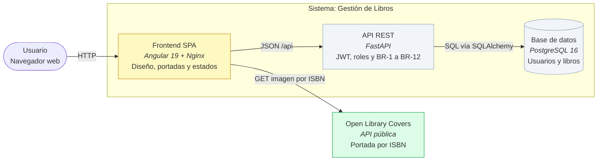

# Design

## Context
El frontend Angular 19 (standalone + signals) ya tiene las ocho vistas funcionando con estilos inline por componente
y un `styles.css` mínimo con ocho variables. Este cambio es **solo de presentación**: no toca la API, ni la base de
datos, ni las reglas de negocio. La única integración nueva es una API externa de solo lectura (Open Library) que se
consume desde el navegador para resolver la portada por ISBN.

Decisiones del usuario en esta sesión: portada resuelta en el frontend (sin columna ni migración), Open Library como
fuente y una ilustración SVG local para el inicio.

## Goals / Non-Goals
**Goals**
- Un sistema de diseño único (tokens + componentes base) aplicado a todas las vistas.
- Portada por ISBN con carga diferida y marcador local cuando no exista.
- Inicio con ilustración local, estado de la API y accesos rápidos por rol.
- Responsive 360–1280 px, accesibilidad AA y estados de carga/vacío/error homogéneos.
- Mantener la cobertura del frontend por encima del 80 % que exige el pipeline.

**Non-Goals**
- Persistir portadas o cambiar el contrato de la API (`docs/PRODUCT.md` secciones 5 y 6 quedan igual).
- Autocompletar metadatos desde Open Library (sería lógica nueva).
- Framework de UI (Tailwind, Material) ni dependencias nuevas.

## Decisions

### D1. La portada se resuelve en el navegador con el ISBN existente
`BookCoverComponent` construye la URL `https://covers.openlibrary.org/b/isbn/<isbn>-L.jpg` a partir del campo `isbn`
que ya devuelve la API. Sin columna nueva, sin migración, sin endpoint nuevo.
**Alternativa descartada:** añadir `cover_url` a `books` con migración y formulario; implica lógica de backend,
cambia el contrato y contradice "no implementar lógica". **Requiere ADR:** no (reversible).

### D2. Open Library como única fuente
`covers.openlibrary.org` no pide clave, permite CORS y acepta ISBN-10 o ISBN-13.
**Alternativa descartada:** Google Books (exige API key y cuota) y doble integración con fallback (más superficie).

### D3. Detección de portada ausente por tamaño de la imagen
Cuando Open Library no tiene la portada devuelve una imagen de relleno de 1×1 (no un 404). El componente escucha
`load` y, si `naturalWidth <= 1`, cambia al marcador local; también lo hace en `error`. El marcador se pinta siempre
debajo de la imagen y solo desaparece cuando la portada carga de verdad, así que una imagen que no responde deja el
marcador a la vista sin necesidad de un temporizador (se descartó el `timeout` de 8 s por estado y tests extra).
**Alternativa descartada:** comprobar el `Content-Type` con `HEAD` (una petición extra por libro y CORS variable).

### D4. Marcador local generado con CSS y las iniciales del título
El placeholder es un `div` con degradado, las iniciales del título y el autor; no descarga ninguna imagen.
**Alternativa descartada:** una imagen genérica de portada (se repite en todo el catálogo y se confunde con una real).

### D5. Tokens en `styles.css` y componentes con clases base
Variables CSS en `:root` (color, tipografía, espaciado, radios, sombras) y clases base (`.btn`, `.card`, `.field`,
`.table`, `.alert`, `.badge`) reutilizadas con modificadores.
**Alternativa descartada:** framework de UI; añade dependencia, peso y necesita ADR.

### D6. Ilustración del inicio como SVG local
`frontend/public/library-hero.svg`, referenciada con `` y un degradado de fondo.
**Alternativa descartada:** foto de stock en el repo (peso, licencia) y URL remota (dependencia de terceros).

### D7. Carga diferida y sin bloqueo del listado
`loading="lazy"`, `decoding="async"` y `width`/`height` fijos para evitar saltos de layout; la tarjeta se pinta
primero y la portada llega después (RNF-07).
**Alternativa descartada:** precargar todas las portadas al entrar (rompe el presupuesto de 1 s con 1 000 libros).

### D8. Estados con los `signal()` existentes
`loading`, `error` y la lista vacía se representan con un patrón común (`<app-state>` o clases compartidas) sin cambiar
la lógica de los componentes.
**Alternativa descartada:** reescribir los componentes con `resource()` de Angular; cambiaría la lógica y los tests.

### D9. Los tests se amplían con la suite Karma existente
Nuevos `*.spec.ts` para `BookCoverComponent` y para los estados visuales; el umbral del 80 % (`karma.conf.js`) sigue
siendo el mismo que exige `ci.yml`.
**Alternativa descartada:** no testear lo visual (bajaría la cobertura global y rompería el pipeline).

## Diagrama C4 (contenedores)



## Contratos

### Externo (solo lectura, desde el navegador)
| Método | URL | Respuesta |
|---|---|---|
| GET | `https://covers.openlibrary.org/b/isbn/{isbn}-L.jpg` | `200` con la imagen de la portada; si no existe, una imagen de relleno de 1×1 |

- `{isbn}` se envía sin guiones ni espacios (el backend ya guarda 10 o 13 dígitos).
- No se envía ningún dato del usuario; el navegador solo hace `GET` de la imagen.

### Interno (componente nuevo)
```ts
// frontend/src/app/shared/book-cover/book-cover.component.ts
@Component({ selector: 'app-book-cover' })
export class BookCoverComponent {
  readonly isbn = input.required<string>();
  readonly title = input.required<string>();
  readonly author = input<string>('');
  readonly size = input<'sm' | 'md' | 'lg'>('md'); // 56, 96 y 160 px de ancho
  readonly lazy = input<boolean>(true);
}
```
Sin salidas: el componente solo pinta la portada o el marcador local.

### Sin cambios
- API REST y tablas: se mantienen tal como están en `docs/PRODUCT.md` secciones 4, 5 y 6.
- Navegación y guards: no se tocan `app.routes.ts` ni los guards.

## Archivos que toca el cambio
| Archivo | Dueño | Nota |
|---|---|---|
| `frontend/src/styles.css` | compartido (no listado en PRODUCT.md §9) | sistema de diseño; PR revisado por el otro dev |
| `frontend/src/index.html` | compartido (no listado en §9) | `lang`, `theme-color` y metadatos |
| `frontend/src/app/app.component.ts` | compartido (no listado en §9) | barra de navegación |
| `frontend/src/app/shared/book-cover/**` | dev-b (nuevo) | componente y su spec |
| `frontend/src/app/shared/state/**` | dev-b (nuevo) | patrón de carga/vacío/error |
| `frontend/public/library-hero.svg` | dev-b (nuevo) | ilustración del inicio |
| `frontend/src/app/features/home/**` | dev-b | inicio |
| `frontend/src/app/features/books/**` | dev-b | catálogo, detalle y formulario |
| `frontend/src/app/features/auth/**` | **dev-a** | login, registro y perfil: coordinación obligatoria |
| `frontend/src/app/features/users/**` | **dev-a** | administración de usuarios: coordinación obligatoria |
| `frontend/src/app/app.routes.ts` | compartido | sin cambios |

## Migration Plan
No hay cambios de esquema ni de despliegue: **no hay migración de Alembic**. El rollback consiste en revertir los
commits del cambio; la API y la base de datos no se ven afectadas.

## Risks / Trade-offs
- **Disponibilidad de Open Library**: si la API externa cae, el catálogo debe seguir operativo con el marcador local
  (D3). No se añade caché persistente en este cambio.
- **Rendimiento del catálogo**: 24 portadas por página con carga diferida; se vigila el presupuesto de RNF-07.
- **Privacidad**: el navegador expone el ISBN a un tercero; se documenta en el PR y no se envía ningún dato de usuario.
- **Archivos de dev-a**: `features/auth/**` y `features/users/**` requieren que dev-a revise el PR o que el rediseño
  de esas vistas se haga en una tarea coordinada.
- **Cobertura**: cada componente nuevo necesita su spec para no bajar del 80 % que exige `ci.yml`.

## Open Questions
- Ninguna bloqueante. El tamaño de las tarjetas y la paleta final se validan en la revisión visual del PR.
